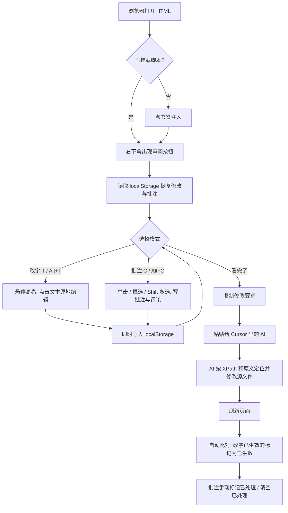
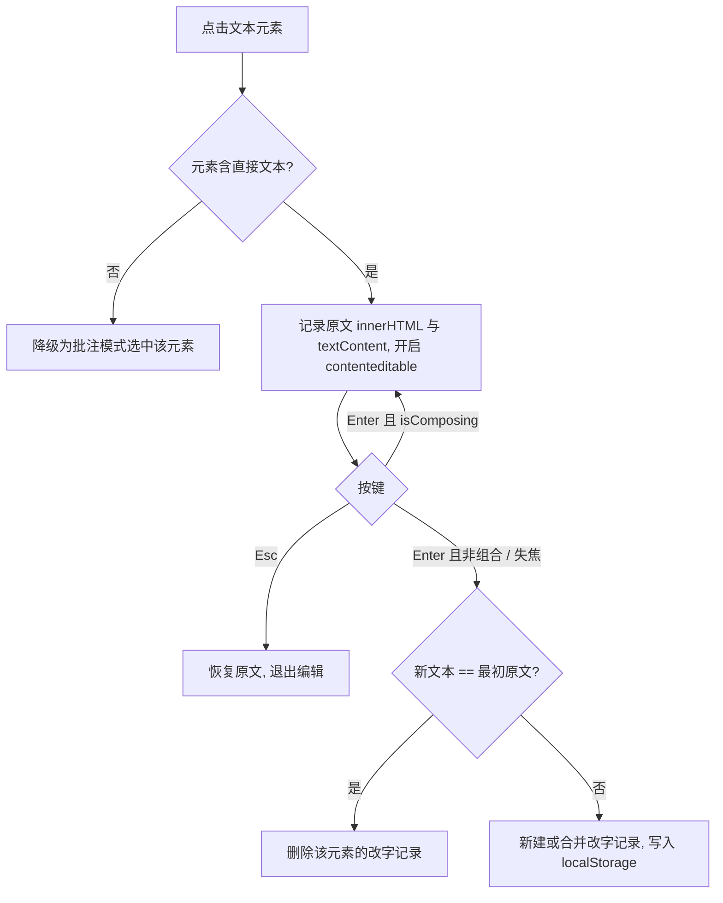
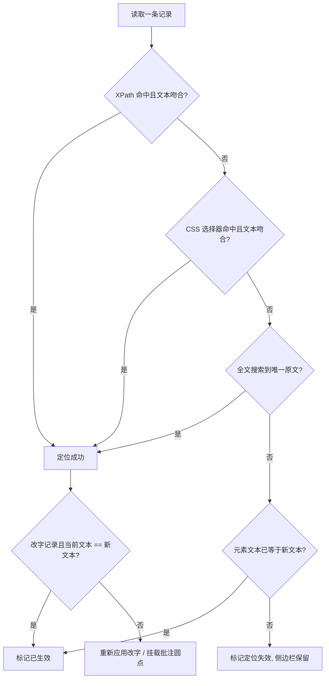
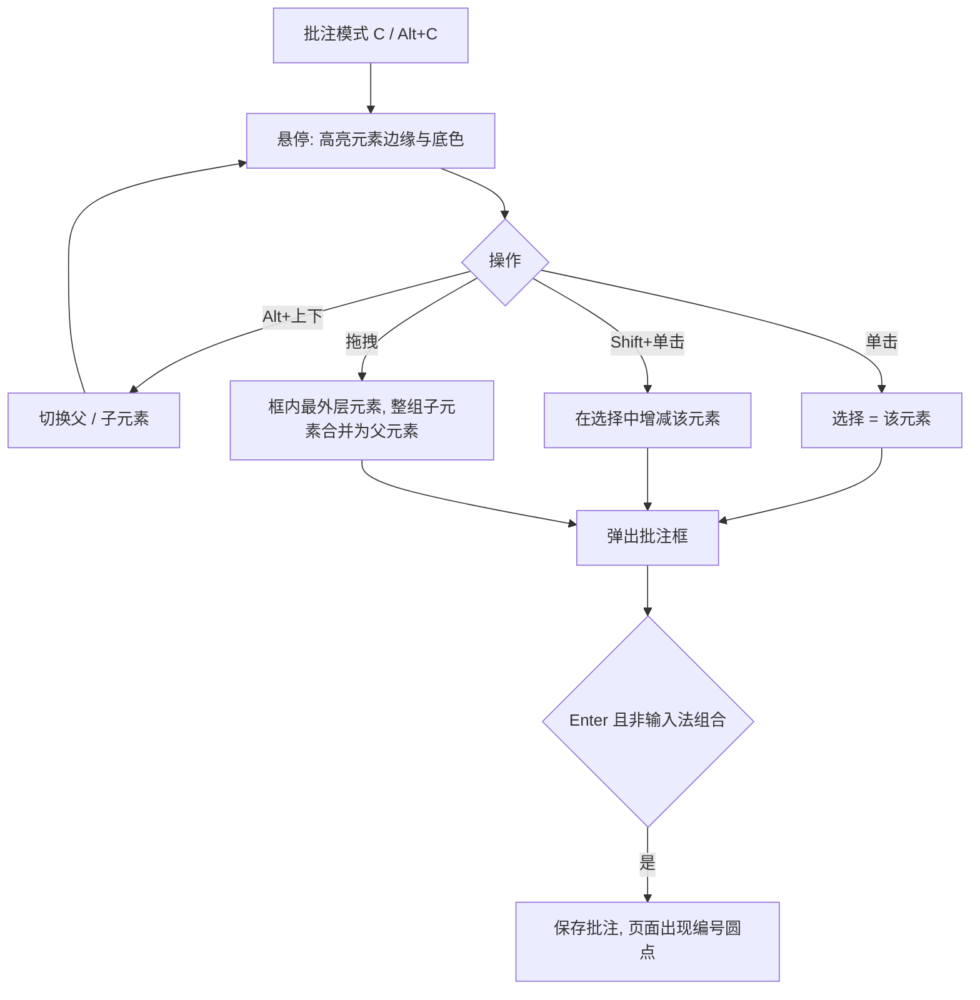
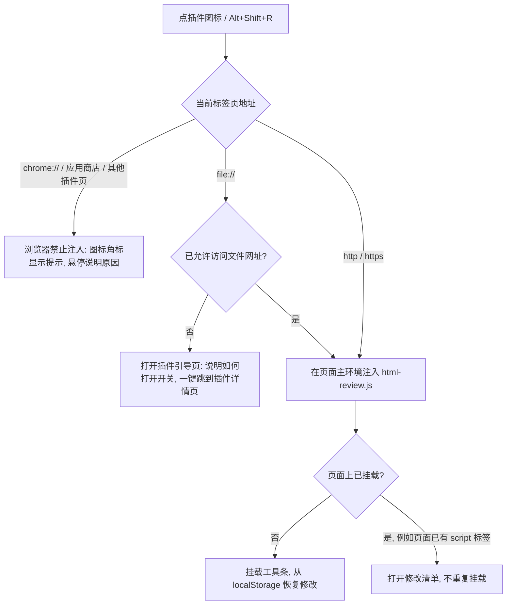

# HTML Review（HTML 审阅模式）PRD

> 版本：v0.1 草案 · 2026-10-22 21:57 · 状态：待确认

## 一、背景与目标

洛小山日常大量产出 HTML 形态的文档：融资 Deck、调研报告、洞察页、宣发素材页。改这些页面的流程是：浏览器里看 → 切回编辑器找源码 → 描述「第几页哪张卡片哪句话」给 AI → AI 改 → 回浏览器刷新。每次切换都打断阅读，描述位置也很费劲。

**目标**：在浏览器里看页面的同时完成全部修改动作。

- 看到哪句话不对，点一下直接改字。
- 看到哪块需要大改，点一下写批注。
- 看完一遍，点「复制修改要求」，粘贴给 AI，AI 拿到的是精确定位（XPath、选择器、原文）加修改意见，一次改完。

## 二、使用场景

- 只有自己用，没有多人协作、没有账号体系。
- 页面是本地 `file://` 打开的静态 HTML，或本地预览服务器上的页面。
- 修改最终由 Cursor 里的 AI 落到源文件；本工具负责采集修改意见，不负责写源文件。

## 三、功能清单

### 3.1 挂载方式

| 方式 | 用法 | 适用 |
|---|---|---|
| Script 标签 | 在 HTML 末尾加一行 `<script src="/Users/.../html-review/dist/html-review.js"></script>` | 自己的项目，长期挂载 |
| 书签栏一键注入（Bookmarklet） | 点浏览器书签，把脚本注入当前页面，原 HTML 一行不改 | 临时审阅任何页面 |

- 产物是**单个 JS 文件**，自带样式和图标，零外部依赖、不依赖 CDN。
- 所有 UI 渲染在 **Shadow DOM** 里，宿主页面的 CSS 不会影响工具 UI，工具 CSS 也不会污染宿主页面。
- 未进入审阅模式时，页面上只有右下角一个小圆按钮，不改动页面任何内容。

### 3.2 三种模式

| 模式 | 快捷键 | 鼠标行为 |
|---|---|---|
| 浏览 | `Esc` | 页面正常交互，只显示批注编号标记 |
| 改字 | `T` 或 `Alt + T` | 悬停时高亮可编辑的文本块（虚线框 + 浅底色），点击后在点击位置出现光标，任意字符可改 |
| 批注 | `C` 或 `Alt + C` | 进入待选中态：悬停高亮元素边缘与浅底色；单击单选，拖拽框选，`Shift + 单击` 增减多选 |

- 再按一次同一快捷键退出该模式，回到浏览。
- 单字母快捷键在输入框、编辑中的文本、批注框里不生效；中文输入法开启时单字母会被输入法吃掉，用 `Alt` 组合键。
- 快捷键在捕获阶段处理并阻止冒泡，避免和 Deck 自带的翻页快捷键冲突。

右下角浮动工具条可切换模式，并显示待处理的修改数量。

### 3.3 改字

- 点击文本元素 → 该元素变为可编辑（`contenteditable`），光标落在点击位置。
- 保留元素内部的行内标记（如 `<span class="lbl">`、`<b>`、`<br>`），只改文字。
- `Enter` 或点击别处：提交；`Shift + Enter`：换行；`Esc`：放弃本次修改。
- **输入法处理**：判断 `isComposing`，输入法确认候选词的回车不会触发提交。
- 提交后立即存入本地（见 3.6），改过的元素加浅色底标记，悬停显示原文。
- 同一元素多次修改合并成一条记录，保留最初原文和最新文本；改回原文时自动删除该条记录。
- 可改字的元素：含直接文本的元素（`p`、`h1-h6`、`li`、`td`、`span`、`a`、`div` 等）。点到不含文本的容器时，自动降级为批注。

### 3.4 批注

- 悬停时高亮当前元素（边框 + 浅底色 + 元素标签）；`Alt + ↑` / `Alt + ↓` 在父元素、子元素间切换选中范围，方便选中整张卡片。
- 三种选中方式：
  - **单击**：选中悬停中的元素，弹出批注框。
  - **框选**：按住拖出矩形，松开后选中两类元素并取最外层：
    - 完整落在矩形内的元素。直接含文字的元素（标题、副标题、段落）按文字实际铺开的范围判断，不按占满整行的盒子判断；卡片、图片、SVG 按盒子判断。
    - 矩形穿过的文字所在的元素：只圈住一段话里的半句，也会选中这段话所在的元素（某行与矩形的重叠高度需达到行高的 60%，避免框边擦到上下行时误选）。
    - 若选中的恰好是某个父元素的全部子元素，自动合并为该父元素。隐藏的元素（如 Deck 中未显示的 slide）不参与。
  - **Shift + 单击**：在当前选择上增减元素，批注框里显示已选数量。
- 一条批注可以对应多个元素，修改单里逐个列出目标。
- 在批注框写修改意见；`Enter` 提交，`Shift + Enter` 换行（同样处理 `isComposing`）。
- 每个目标元素自动采集：
  - XPath（如 `/html/body/div[1]/div[3]/p[2]`）
  - CSS 选择器（优先用 id / class 生成最短唯一选择器）
  - 元素文本摘要（前 200 字）和 outerHTML 片段（截断到 1500 字）
  - 所在章节：向上找最近的 `h1-h3` 标题文字，帮助 AI 和人理解上下文
- 页面上在元素右上角显示编号圆点，点击圆点展开该条批注。
- 批注可追加评论（同一主题的补充想法），可编辑、删除、标记「已处理」。

### 3.5 侧边栏

- 右侧抽屉列出全部修改，按页面位置排序，分「改字」「批注」两组，可筛选「待处理 / 已导出 / 已处理」。
- 点击条目：页面滚动到对应元素并闪烁高亮。
- 改字条目显示「原文 → 新文」对比。
- 批量还原改字：底部按钮。勾选了改字时为「还原选中改字（N）」，只还原勾选的；没勾选改字时为「还原全部改字（N）」，还原全部待处理 / 已导出的改字。页面恢复原文、记录删除；已生效 / 已处理的改字和批注不受影响。不弹确认框，还原后提示条提供「撤回」。

### 3.6 本地保存与恢复

- 存储：`localStorage`，按页面路径隔离（键：`html-review:v1:<页面路径>`）。每次改动即时写入。
- 刷新或重新打开页面后自动恢复：
  - 改字记录重新应用到页面上，页面显示的是改后的样子。
  - 批注圆点重新挂到对应元素上。
- 元素重新定位顺序：XPath 命中且文本吻合 → CSS 选择器命中且文本吻合 → 全文搜索原文 → 都失败则标记「定位失效」，条目保留在侧边栏，不丢数据。
- **自动识别已生效**：AI 改完源文件、你刷新页面后，如果某条改字记录对应元素的文本已经等于新文本，该记录自动标为「已生效」，不再重复应用。
- 备份：侧边栏可「导出修改单（.xml 文件）」和「导入修改单」，防止清浏览器数据时丢失。

### 3.7 复制修改要求

- 点「复制修改要求」→ 把所有「待处理」条目拼成一段完整提示词，写入剪贴板，并提示「已复制 N 条」。
- 复制后这些条目状态变为「已导出」（可撤回）。
- 提示词结构见第五节。数据部分用 XML 表达（XML 比 JSON 更适合大模型逐条读取）。
- 同时支持「只复制选中的条目」。

## 四、流程图

### 4.1 整体流程



### 4.2 改字提交



### 4.3 刷新后定位恢复



## 五、复制出的提示词（草案）

```text
请按下面的修改单修改源文件。

源文件：/Users/you/Documents/.../insight/index.html
页面标题：「别人」放在哪里，AI 就会被放在哪里…
导出时间：2026-10-22 22:10

规则：
1. 用 xpath 和 selector 定位元素，用 before 原文核对，三者以原文为准。
2. text_edit 类条目：把 before 改为 after，保留元素内的行内标签和属性。
3. comment 类条目：按 request 和 replies 里的意见修改 target 元素，可以改文案、结构或样式。
4. 只改条目涉及的内容，其余代码保持原样。
5. 改完后逐条回报：已修改 / 无法定位 / 需要确认（附原因）。

<review page="index.html" count="2">
  <item id="E1" type="text_edit">
    <xpath>/html/body/div[1]/h2[1]</xpath>
    <selector>#thesis</selector>
    <section>结论与推理链</section>
    <before>结论与推理链</before>
    <after>结论与推理</after>
  </item>
  <item id="C1" type="comment">
    <xpath>/html/body/div[1]/div[2]</xpath>
    <selector>div.grid3</selector>
    <section>起点：独处是默认，「别人」有三种位置</section>
    <target_text>真空 第一名去没人的安静处 · 20% …</target_text>
    <target_html><![CDATA[<div class="grid3">…</div>]]></target_html>
    <request>三张卡片改成横向条形图，突出 66%</request>
    <replies>
      <reply>颜色沿用全文的主色</reply>
    </replies>
  </item>
</review>
```

## 六、技术方案

### 6.1 技术选型

| 项 | 选择 | 理由 |
|---|---|---|
| 语言 | TypeScript | 类型约束定位、存储等核心逻辑 |
| UI | **原生 DOM + Shadow DOM**（不用 React） | 见 6.2 |
| 构建 | esbuild，打包为单个 IIFE 文件 | 产物小、构建快，满足「一个文件挂到任何页面」 |
| 图标 | Lucide（SaaS 工具调性），SVG 源文件下载到本地并内联打包 | 不依赖 CDN |
| 测试 | Vitest + jsdom | 覆盖定位、存储、合并、导出等核心逻辑 |

### 6.2 偏离规范说明：不使用 React

开发规范 6.2 要求前端使用 React。本工具是注入到任意宿主页面的浮层组件，使用 React 会带来：

- 产物增加约 40KB，书签注入变慢；
- 宿主页面若自带 React，可能产生版本冲突；
- UI 只有工具条、批注框、侧边栏三块，原生实现即可覆盖。

因此本工具采用原生 TypeScript + Shadow DOM。**此项需要你确认。**

### 6.3 工程结构

```text
html-review/
├── PRD.md
├── README.md                 # 挂载方法、快捷键
├── LICENSE                   # MIT
├── package.json
├── build.mjs                 # esbuild 构建 + 生成 bookmarklet
├── src/
│   ├── index.ts              # 入口：防重复挂载、初始化
│   ├── store.ts              # 状态与 localStorage 读写
│   ├── locator.ts            # XPath / CSS 选择器生成与反查、章节识别
│   ├── restore.ts            # 刷新后重新定位、已生效判断
│   ├── modes/
│   │   ├── textEdit.ts       # 改字模式
│   │   └── comment.ts        # 批注模式、父子元素切换
│   ├── ui/
│   │   ├── shadowRoot.ts     # Shadow DOM 容器
│   │   ├── toolbar.ts        # 右下角工具条
│   │   ├── overlay.ts        # 悬停框、编号圆点
│   │   ├── commentPopover.ts # 批注框与评论
│   │   ├── sidebar.ts        # 侧边栏
│   │   ├── icons.ts          # Lucide SVG
│   │   └── styles.css
│   ├── export/
│   │   ├── prompt.ts         # 拼装提示词
│   │   └── xml.ts            # 修改单 XML 导出 / 导入
│   └── keyboard.ts           # 快捷键、isComposing 处理
├── playground/
│   └── index.html            # 组件演示页 + 测试用文档
├── dist/
│   ├── html-review.js
│   └── bookmarklet.txt
├── tests/
│   ├── test_locator.ts
│   ├── test_store.ts
│   ├── test_restore.ts
│   └── test_export.ts
└── docs/
    ├── FEATURES.md
    ├── CHANGELOG.md
    └── METHODOLOGY.md
```

### 6.4 依赖（均为开发依赖，产物零运行时依赖）

| 依赖 | 用途 |
|---|---|
| `typescript` | 类型检查 |
| `esbuild` | 打包单文件 |
| `vitest`、`jsdom` | 单元测试 |
| `lucide-static` | 获取 Lucide SVG 源文件，构建时内联 |

### 6.5 PlayGround

`playground/index.html` 包含：

- 工具条、悬停框、编号圆点、批注框、评论列表、侧边栏条目各自的独立 demo；
- 一份模拟报告页（标题、段落、行内标签、卡片栅格、表格、列表），用于端到端测试改字和批注；
- 提示词模板全文展示，方便调整措辞。

## 七、边界与已知限制

- **改字只改浏览器里的页面**。源文件由 AI 按修改单改，这是你选择的方案。
- JS 运行时生成的内容（如动态渲染的图表）：可以批注，改字后刷新可能定位失效，这时 AI 需要去改生成它的数据或代码。
- 内容被 JS 反复重绘的页面：重绘后会重新挂载圆点和改字效果（监听 DOM 变化）。
- `file://` 页面在 Chrome 中共享同一个 localStorage，靠页面路径区分，同一路径的文件改名后旧记录不会自动迁移（可用导出 / 导入搬运）。
- 书签注入在设置了严格 CSP 的线上网站可能被拦截；本地文件和本地预览服务器不受影响。

## 八、开发代价

- 复杂度：中。难点在元素定位的稳定性（刷新、DOM 重绘后能找回）、`contenteditable` 下保留行内标记、Shadow DOM 与宿主页面的事件隔离。
- 预计工作量：编码 + 测试 + PlayGround 约 1 个完整工作单元，可在本次会话内完成。
- 外部依赖：无 AI 接口、无服务端。

### 4.4 批注选择



## 九、确认记录

- [2026-10-22 22:01] PRD 获批开工。快捷键调整为改字 `T` / `Alt + T`、批注 `C` / `Alt + C`；批注支持框选与多选，悬停高亮边缘。
- 不使用 React，采用原生 TS + Shadow DOM（见 6.2）。
- GitHub 仓库暂不创建，待另行确认。
- [2026-10-22 22:49] 开源到 GitHub 组织仓库 `miyang-ai/html-review`，MIT 协议，版权归 Miyang Tech (Shanghai) Co., Ltd.；README 顶部加 Agent Skill 入口。
- [2026-10-22 22:56] 浏览器插件方案获批开工（第十章）：GitHub Release + 应用商店材料、Chrome 系、点击注入、数据存页面 localStorage。追加要求：引导页加米羊官网、「关于」公司信息和招聘邀请（见 10.7）。

## 十、浏览器插件（v0.2.0）

### 10.1 需求复述

把现有工具再包一层 Chrome 插件，作为第三种挂载方式，和 script 标签、书签并存，同一份核心代码一起构建、一起发布。

- **触发**：点浏览器工具栏上的插件图标，或按快捷键 `Alt+Shift+R`（可在 `chrome://extensions/shortcuts` 改），只在当前标签页注入。已经挂载的页面再触发一次，打开修改清单（与书签行为一致）。
- **权限最小化**：只申请 `activeTab` 和 `scripting`。安装时不出现「读取和更改您在所有网站上的数据」警告；插件只在你点击的那个标签页、那一刻拿到权限。
- **数据**：继续存页面的 `localStorage`，键名不变。同一个页面无论用 script 标签、书签还是插件打开，看到的是同一份修改记录。
- **浏览器**：Chrome 系（Chrome、Edge、Arc、Brave），Manifest V3。
- **发布**：两条渠道。
  - GitHub Release 附插件 zip，解压后在 `chrome://extensions` 打开开发者模式、「加载已解压的扩展程序」即可用；clone 仓库的人也可以直接加载 `dist/extension/`。
  - 准备好 Chrome 应用商店上架所需的全部材料（商店文案中英文、截图、宣传图、隐私说明、权限用途说明），由你用米羊的开发者账号提交审核。

### 10.2 相比书签的改进

| 场景 | 书签 | 插件 |
|---|---|---|
| 本地 `file://` 页面 | 可用 | 可用，需在插件详情页打开「允许访问文件网址」（首次会引导） |
| 设置了严格 CSP 的线上网站（GitHub、Notion 等） | 被拦截 | 可用，插件注入不受页面 CSP 限制 |
| 触发方式 | 点书签栏 | 点图标或快捷键 |
| 更新 | 重新拖一次书签 | 应用商店自动更新；zip 版重新加载 |

### 10.3 注入流程



注入到页面主环境（MAIN world），和 script 标签挂载共用同一个防重复标记 `window.__htmlReview`。如果注入到插件的隔离环境，看不到页面上已经通过 script 标签挂载的实例，会出现两套工具条。

### 10.4 工程改动

```text
extension/
├── manifest.json        # MV3：action、commands、background service worker；permissions: activeTab, scripting
├── background.ts        # 点击 / 快捷键 → 判断页面类型 → 注入或引导；不可注入时设置角标与提示
├── help.html / help.ts  # 引导页：打开文件网址访问权限、快捷键、使用说明
└── icons/               # 16 / 32 / 48 / 128 PNG（由 Lucide pen-line 渲染，和工具条主按钮同款）
scripts/
└── render-icons.mjs     # 用 puppeteer-core 把 SVG 渲染成各尺寸 PNG，产物提交到仓库，构建时不依赖浏览器
store/                   # 应用商店上架材料
├── listing.zh.md / listing.en.md   # 名称、简介、详细说明
├── privacy.md                       # 隐私说明：不收集、不上传任何数据，记录只存在本地浏览器
├── permissions.md                   # activeTab / scripting 用途说明（审核必填）
└── screenshots/                     # 1280×800 截图 ×3、440×280 宣传图，由脚本从 PlayGround 生成
```

- `build.mjs`：额外输出 `dist/extension/`（manifest、background.js、help、icons、html-review.js 副本），可直接「加载已解压的扩展程序」。
- `npm run pack:ext`：把 `dist/extension/` 打成 `release/html-review-extension-v0.2.0.zip`（`release/` 不进仓库，发布时上传到 GitHub Release）。打包 zip 需要新增开发依赖 `fflate`（约 30KB、零依赖的压缩库），用来在 Node 里生成 zip，避免依赖系统 `zip` 命令。
- 版本号统一从 `package.json` 读取，构建时注入到 manifest、脚本头部注释和 `window.__htmlReview.version`，版本升到 `0.2.0`。
- README「挂载方式」加插件一行和安装步骤；Skill 里补充「用户装了插件时无需改 HTML」。
- 核心代码 `src/` 只改样式注入方式：工具 UI 和页面级样式改用可构造样式表（`adoptedStyleSheets`），不支持时回退 `<style>`。原因：插件能注入严格 CSP 的网站，但 CSP 的 `style-src` 会拦截脚本插入的 `<style>`，工具条会变成无样式的裸按钮；可构造样式表不受这条限制。三种挂载方式同时受益。

### 10.7 引导页内容

引导页在首次安装、或在 `file://` 页面上触发但未允许访问文件网址时打开，依次为：

1. 本地文件访问：实时显示「允许访问文件网址」状态，未允许时给出三步操作和「打开插件详情页」按钮；切回本页自动重新检测。
2. 怎么用：快捷键表、「修改快捷键」按钮、GitHub 链接。
3. 数据与隐私：只作用于当前标签页、数据只在本地、三种挂载方式数据互通。
4. 关于：米羊科技（上海）有限公司介绍（使命、愿景、旗下产品、这个工具的来历）、地址、官网 miyang.cn、联系邮箱 contact@miyang.ai。
5. 我们在招人：招聘邀请、待遇标签、「查看在招职位」（miyang.cn/careers）、简历投递邮箱 eason@miyang.ai。

README 末尾同步加「关于」和「我们在招人」两节，应用商店详细说明末尾附官网和招聘链接。

### 10.5 测试

用 puppeteer-core 在本机 Chrome 中加载 `dist/extension/`，通过本地 http 服务提供测试页，直接调用 service worker 里的注入函数模拟点击图标。activeTab 只能由真实点击授予，测试用的插件副本额外加 `host_permissions`，后台逻辑与正式包相同：

1. 普通页面：注入后工具条出现，改字可保存。
2. 再触发一次：打开修改清单，页面上只有一个工具条。
3. 页面已用 script 标签挂载：触发插件不重复挂载。
4. 响应头带严格 CSP（`script-src 'self'`）的页面：插件注入成功。
5. 用 script 标签挂载时保存的修改，在插件注入的同一页面上能看到（数据互通）。
6. 不可注入的页面：角标提示，无报错。

### 10.6 开发代价

- 复杂度：低到中。核心逻辑全部复用，新增的是插件外壳、引导页、图标、上架材料和测试。
- 工作量：本次会话内可完成，包括测试和发布 GitHub Release v0.2.0。
- 需要你做的：提交应用商店审核（需要 Chrome 开发者账号，一次性注册费 5 美元；审核通常几天）。
- 新增依赖：开发依赖 `fflate`（见 10.4）。
